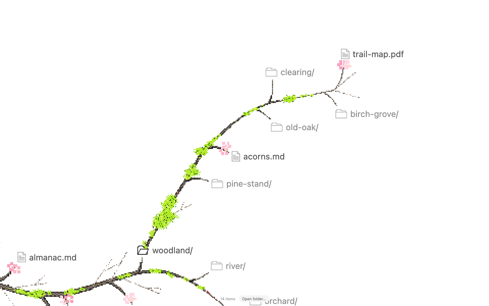
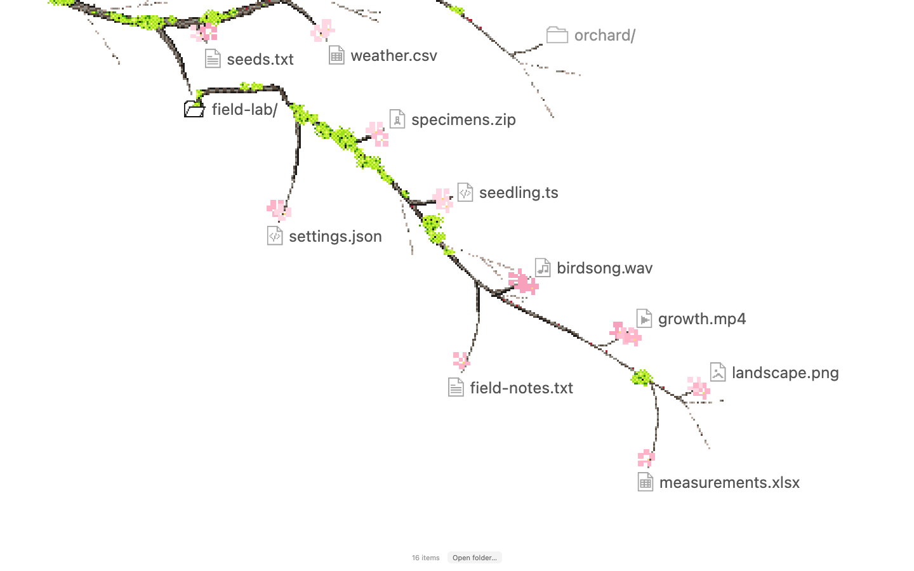

# Literal File Tree

A file tree that grows like a real tree. Open folders to reveal new branches, pixel-art bark, moss, and cherry blossoms.

Built with JavaScript, HTML, SVG, and Canvas. Vite serves the app locally and bundles its Lucide icons for production; there is no frontend framework.

https://github.com/user-attachments/assets/16a90849-e181-4e9f-9251-e8c014dad124

<details>
<summary>More screenshots</summary>





</details>

Screenshots and video were captured in Chromium with normal growth animations enabled.

## Run locally

Requires Node.js and npm. From the project directory:

```sh
npm install
npm run dev
```

Open the local URL printed by Vite. It starts at `http://localhost:3000` and automatically tries the next port if that one is busy. The app must be served over HTTP; opening `index.html` directly will prevent its module imports and demo data from loading.

## Explore

- **Open or close a folder:** click it, or focus it with Tab and press Enter or Space.
- **Folder actions:** right-click a folder, or use the keyboard context-menu key / Shift+F10, to expand or collapse it and copy its path.
- **Pan:** drag the background, or scroll with a mouse wheel or trackpad.
- **Zoom:** pinch on a trackpad or touchscreen, or press Ctrl/Cmd + `+` / `−`. Ctrl/Cmd + `0` resets the view.
- **Zoom with a mouse on macOS:** hold Cmd and drag up or down.
- **Fit the tree:** enable **Auto zoom to fit tree**, or press `A`. It zooms in or out as needed; turning it off keeps the current camera position.
- **Go up one folder:** press Escape.
- **Hide the controls:** use the eye button beside **Open folder…**.

The controls panel includes sliders for pixel size, growth pace, blossom size, branch thickness, and moss coverage. Reset an adjusted slider on its own, or use the header reset button to restore all sliders.

On touchscreens, drag with one finger to pan and pinch with two fingers to zoom. The app respects reduced-motion preferences.

## Use your own tree

### Pick a folder

Choose **Open folder…** in the controls panel. The tree is built from the selected folder's relative file names. The browser keeps the selected files local; it does not upload them. Clicking a file opens its selected contents in a new browser tab. The browser does not provide the original path needed to launch the file in a desktop app.

### Drop a path list

Drop a plain-text file onto the page, with one relative path per line:

```text
# A small example
src/main.ts
src/styles.css
images/landscape.png
audio/birdsong.wav
reports/measurements.csv
archive/specimens.zip
notes/
```

A trailing `/` marks an empty folder. Blank lines and lines beginning with `#` are ignored. Duplicate paths are merged, backslash separators are accepted, and insertion order is preserved.

For a Git project, create a list of tracked files:

```sh
git ls-files > /tmp/project-tree.txt
```

Then drop `project-tree.txt` onto the page. The list is read in the browser.

### Load a path list by URL

By default, the app loads [`tree.txt`](tree.txt). Replace it to change the starting tree, or pass another path list in the `tree` query parameter:

```text
http://localhost:3000/?tree=video-tree.txt
```

The value can be a relative or absolute URL. Cross-origin sources must allow browser requests through CORS. The app fetches the path list when the page loads; folder selection and dropped lists stay in the browser.

## Build and host

Create a production build and preview it locally:

```sh
npm run build
npm run preview
```

Publish the generated `dist/` directory to any static host, including [GitHub Pages](https://docs.github.com/en/pages/getting-started-with-github-pages/what-is-github-pages). No application server is needed after the build.

## Checks

```sh
node parse.test.mjs
node layout.test.mjs
```

The checks cover path parsing, icons, branch and text clearance, nested routes, collapse/reopen behavior, zoom limits, pixel alignment, and animation geometry. They do not replace browser compatibility testing.

| File | Purpose |
| --- | --- |
| `index.html` | Interface, drawing, layout, camera, and interactions |
| `parse.js` | Converts path lists into a tree |
| `tree.txt` | Main woodland demo, including file-type examples |
| `video-tree.txt` | Smaller reference tree |
| `parse.test.mjs` | Parser regression checks |
| `layout.test.mjs` | Layout, rendering, and interaction regression checks |

Large or deeply nested trees can take longer to lay out. The demo has been checked in Chromium; Firefox, Safari, and physical touch devices have not been verified.

## Project files

## Credits

Inspired by [Finn Taylor's literal file-tree prototype](https://x.com/FinnoTaylor/status/2112286571999428676). This repository is an open-sourced and tweaked implementation of that idea.

## License

[MIT](LICENSE) © 2026 Srujan Ponnapalli.
